<div align="center">

# Nur Jamal Babu
### Senior Full-Stack Laravel Architect & AI Automation Engineer
**Dhaka, Bangladesh** · [Email](mailto:nurjamalbabu949@gmail.com) · [GitHub Profile](https://github.com/nur949)

<p align="center">
  
  
  
  
</p>

<p align="center">
  <i>Specializing in enterprise Laravel applications, clean domain architectures, high-conversion e-commerce engines, and resilient AI automation pipelines.</i>
</p>

---

</div>

## 📐 Architecture & Engineering Standards

```text
┌──────────────────────────────────────────────────────────────────────────────────────────────────┐
│  BACKEND       : Laravel 11+, PHP 8.2+, Thin Controllers, FormRequests, Domain Actions, Policies │
│  FRONTEND      : Livewire 3 (Computed properties, lazy load), Alpine.js, Custom Tailwind CSS    │
│  DATABASE      : MySQL (Indexed Foreign Keys, Zero N+1 Eager Loading), PostgreSQL, Redis         │
│  AI AUTOMATION : Autonomous Agents, Headless Puppeteer / Playwright, Queue Workers, Webhooks      │
└──────────────────────────────────────────────────────────────────────────────────────────────────┘
```

- **Domain-Driven Laravel Architecture:** Strict separation of concerns. Controllers contain zero business logic; incoming payloads are validated at the perimeter with dedicated `FormRequest` classes, business rules execute within reusable `Action` / `Service` classes, and multi-table writes run inside `DB::transaction()`.
- **Zero N+1 Query Discipline:** Every relational read is strictly bound with eager loading (`with()`), selecting only projected columns to keep database payloads ultra-lean.
- **Modern Reactive UI Without Overhead:** Livewire 3 paired with Alpine.js delivers dynamic SPA feel with server-rendered security, eliminating unnecessary SPA bundle bloat.
- **Autonomous AI & Web Automation:** Headless browser bots (Puppeteer & Playwright) engineered for high-concurrency data extraction, full-viewport visual verification, automated cron jobs, and LLM agent function calling (Gemini / OpenAI).

---

## 🛠️ Technology Stack

| Domain | Technologies & Frameworks |
| :--- | :--- |
| **Backend** | **Laravel 11+**, PHP 8.2+, Django REST Framework, Python, Node.js |
| **Frontend** | **Livewire 3**, Alpine.js, Blade Components, React.js, Tailwind CSS, Vite |
| **AI & Automation** | Autonomous Agents, Gemini API, OpenAI SDK, Headless Puppeteer, Playwright |
| **Databases** | MySQL (Strictly indexed), PostgreSQL, Redis (Cache & Background Queues) |
| **Security & Auth** | Sanctum, JWT, CSRF Hardening, Parameterized SQL, Role-Based Access Control (RBAC) |
| **DevOps & Cloud** | Linux (Ubuntu), Nginx, Docker, Git, GitHub Actions, Vercel, Render |

---

## 🤖 AI Automation & Workflow Architecture

```text
  [ Web & API Ingestion ]  ───>  [ LLM Decision Core ]  ───>  [ Autonomous Action Engine ]
  • Headless Puppeteer/Playwright  • Gemini / OpenAI Agents    • Background Queue Workers
  • Webhook Receivers             • Function Calling / Schemas • DB Sync & Automated Dispatch
```

- **Headless Browser Bots:** Autonomous scripts capturing multi-viewport assets, full-length screenshots, and continuous catalog sync.
- **Agentic Decision Engines:** LLM integrations utilizing strict JSON schema enforcement to automate data classification, customer inquiry routing, and reporting.
- **Event-Driven Automation:** Scheduled jobs, retry-capable queue workers, and automated transaction verification.

---

## 🌐 Production Client Deployments (Full Home Page Showcase)

Below is the verified production index of **18 live client websites**. Each project includes its **complete full-length home page desktop scroll** alongside its responsive **mobile viewport**, architectural highlights, and live URL.

---

### Category A: E-Commerce & Retail Systems

---

#### 01. Shohoj Kena — Authentic Korean Skincare
| Property | Value |
| :--- | :--- |
| **Live URL** | [http://shohojkena.com/ ↗](http://shohojkena.com/) |
| **Domain** | Direct-to-Consumer Beauty & Skincare |
| **Architecture** | High-conversion catalog, dynamic multi-brand filters (COSRX, Anua), cart state, nationwide bKash / Nagad / Cash on Delivery. |

| Desktop (Complete Home Page Scroll) | Mobile Viewport |
| :---: | :---: |
| <a href="http://shohojkena.com/"></a> | <a href="http://shohojkena.com/"></a> |

---

#### 02. CareMi Beauty — Premium K-Beauty Retail
| Property | Value |
| :--- | :--- |
| **Live URL** | [https://caremibeauty.com/ ↗](https://caremibeauty.com/) |
| **Domain** | Authentic Skincare & Cosmetics E-Commerce |
| **Architecture** | Minimalist aesthetic, routine-based product grouping, live stock inventory, instant checkout, mobile payment integration. |

| Desktop (Complete Home Page Scroll) | Mobile Viewport |
| :---: | :---: |
| <a href="https://caremibeauty.com/">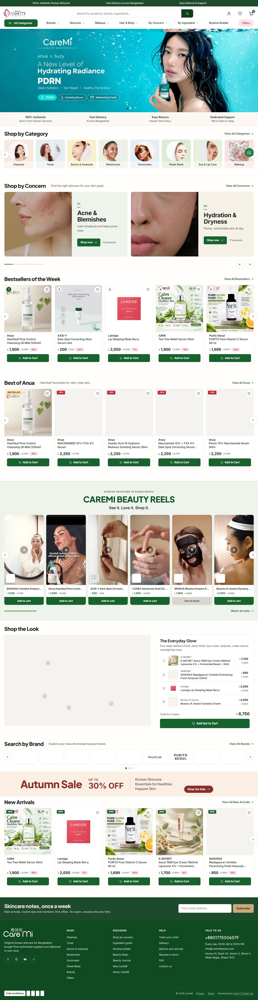</a> | <a href="https://caremibeauty.com/"></a> |

---

#### 03. Mimi's Cosmetics Creation — Beauty, Makeup & Fragrance
| Property | Value |
| :--- | :--- |
| **Live URL** | [https://mimiscosmeticscreation.com/ ↗](https://mimiscosmeticscreation.com/) |
| **Domain** | Makeup, Skincare & Fragrance Retail |
| **Architecture** | Shade & variant selectors, promotional banner engine, responsive search filter, single-page frictionless ordering. |

| Desktop (Complete Home Page Scroll) | Mobile Viewport |
| :---: | :---: |
| <a href="https://mimiscosmeticscreation.com/"></a> | <a href="https://mimiscosmeticscreation.com/"></a> |

---

#### 04. Shahe Bazar — Online Grocery & Daily Essentials
| Property | Value |
| :--- | :--- |
| **Live URL** | [https://shahebazar.com/ ↗](https://shahebazar.com/) |
| **Domain** | FMCG & Perishable Food E-Commerce |
| **Architecture** | Large-scale inventory categorization (grocery, fresh produce, meat, dairy), local delivery slot routing, cash on delivery. |

| Desktop (Complete Home Page Scroll) | Mobile Viewport |
| :---: | :---: |
| <a href="https://shahebazar.com/"></a> | <a href="https://shahebazar.com/">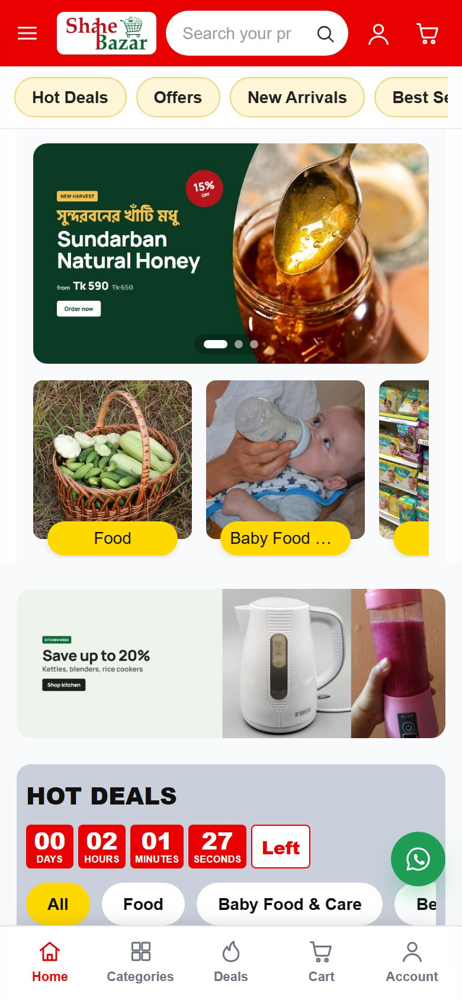</a> |

---

#### 05. Rev Auto BD — Automotive Parts & Accessories
| Property | Value |
| :--- | :--- |
| **Live URL** | [https://revautobd.com/ ↗](https://revautobd.com/) |
| **Domain** | Automotive Aftermarket & Car Care |
| **Architecture** | Vehicle model compatibility selector, dynamic accessory bundles, technical specs tabs, countrywide courier fulfillment. |

| Desktop (Complete Home Page Scroll) | Mobile Viewport |
| :---: | :---: |
| <a href="https://revautobd.com/">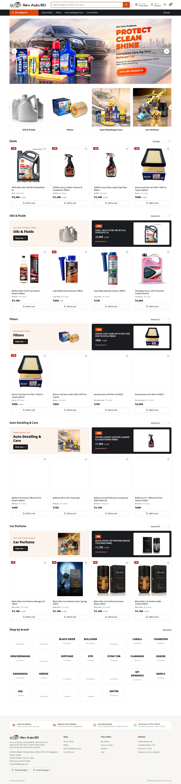</a> | <a href="https://revautobd.com/">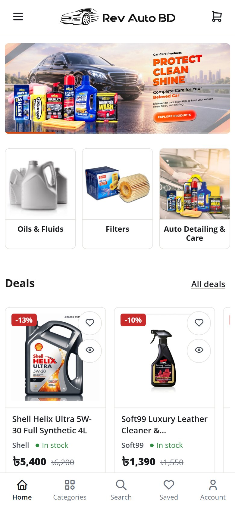</a> |

---

#### 06. SF Enterprise — Battery Solutions & Power Equipment
| Property | Value |
| :--- | :--- |
| **Live URL** | [https://sfenterprisebd.com/ ↗](https://sfenterprisebd.com/) |
| **Domain** | Industrial, Solar & Automotive Batteries |
| **Architecture** | Authorized distributor portal for Pollo Supreme & Nexcell, battery warranty registration, dealer quote request hub. |

| Desktop (Complete Home Page Scroll) | Mobile Viewport |
| :---: | :---: |
| <a href="https://sfenterprisebd.com/"></a> | <a href="https://sfenterprisebd.com/">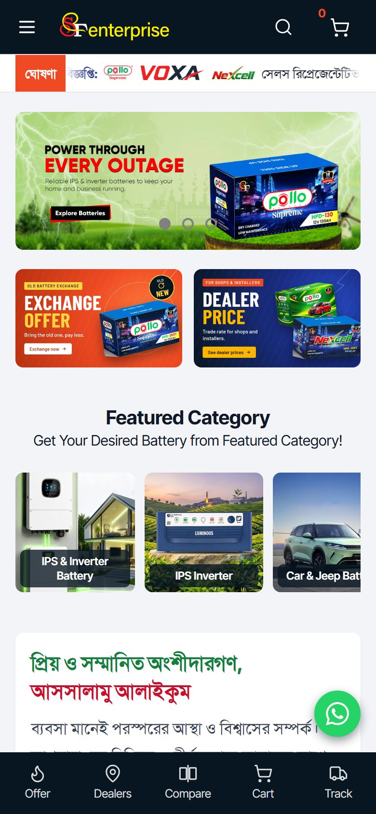</a> |

---

#### 07. Tanha Bag Fashion — Handbags & Accessories
| Property | Value |
| :--- | :--- |
| **Live URL** | [https://tanhabagfashionbd.com/ ↗](https://tanhabagfashionbd.com/) |
| **Domain** | Fashion & Leather Goods Retail |
| **Architecture** | Editorial product gallery, touch-optimized image carousels, responsive bag taxonomy (totes, crossbody), rapid cart flow. |

| Desktop (Complete Home Page Scroll) | Mobile Viewport |
| :---: | :---: |
| <a href="https://tanhabagfashionbd.com/"></a> | <a href="https://tanhabagfashionbd.com/"></a> |

---

#### 08. ShopnerHut — Boutique Ladies Fashion Store
| Property | Value |
| :--- | :--- |
| **Live URL** | [https://www.shopnerhut.xyz/ ↗](https://www.shopnerhut.xyz/) |
| **Domain** | Women's Bags & Lifestyle Retail |
| **Architecture** | Localized Bengali UI, customer feedback highlights, WhatsApp floating checkout trigger, verified cash on delivery. |

| Desktop (Complete Home Page Scroll) | Mobile Viewport |
| :---: | :---: |
| <a href="https://www.shopnerhut.xyz/"></a> | <a href="https://www.shopnerhut.xyz/"></a> |

---

#### 09. E&E World — Premium Headwear & Apparel
| Property | Value |
| :--- | :--- |
| **Live URL** | [https://eeworldbd.com/ ↗](https://eeworldbd.com/) |
| **Domain** | International Standard Cap Manufacturing |
| **Architecture** | Multi-style cap catalog (trucker, snapback, fitted), brand legacy timeline, bulk institutional order requests, direct sales. |

| Desktop (Complete Home Page Scroll) | Mobile Viewport |
| :---: | :---: |
| <a href="https://eeworldbd.com/"></a> | <a href="https://eeworldbd.com/"></a> |

---

### Category B: Industrial, Engineering & Supply Chain

---

#### 10. Sky Elevator and Technology Ltd. — Vertical Lift Engineering
| Property | Value |
| :--- | :--- |
| **Live URL** | [https://skyelevatortec.com/ ↗](https://skyelevatortec.com/) |
| **Domain** | Commercial, Hospital & Freight Elevators |
| **Architecture** | Heavy engineering portfolio (passenger, hospital bed, panoramic lifts, escalators), sub-station specs, online RFQ system. |

| Desktop (Complete Home Page Scroll) | Mobile Viewport |
| :---: | :---: |
| <a href="https://skyelevatortec.com/">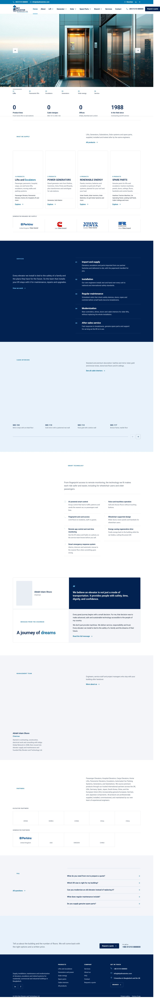</a> | <a href="https://skyelevatortec.com/">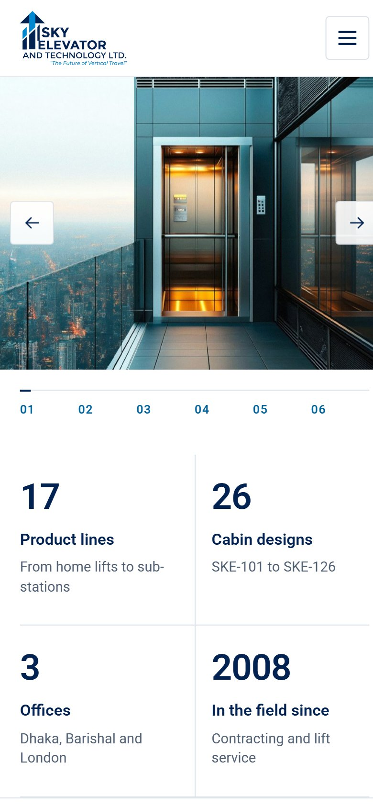</a> |

---

#### 11. Sky HD Elevator — German Engineering Lift Systems
| Property | Value |
| :--- | :--- |
| **Live URL** | [https://sky.marketleadbd.com/ ↗](https://sky.marketleadbd.com/) |
| **Domain** | Heavy Industrial Lift Systems & Moving Walks |
| **Architecture** | German standard technical documentation, heavy vehicle lifts, moving walkway engineering, component safety architecture. |

| Desktop (Complete Home Page Scroll) | Mobile Viewport |
| :---: | :---: |
| <a href="https://sky.marketleadbd.com/"></a> | <a href="https://sky.marketleadbd.com/">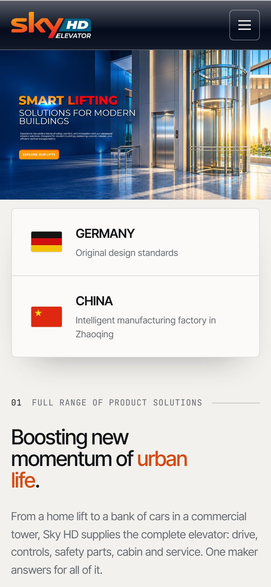</a> |

---

#### 12. GreenLeaf Packaging — Sustainable Packaging Manufacturing
| Property | Value |
| :--- | :--- |
| **Live URL** | [https://greenleafpackbd.com/ ↗](https://greenleafpackbd.com/) |
| **Domain** | Eco-Friendly Industrial Packaging |
| **Architecture** | Eco-packaging showcase, environmental certification matrix, corporate client references, direct sales consultation portal. |

| Desktop (Complete Home Page Scroll) | Mobile Viewport |
| :---: | :---: |
| <a href="https://greenleafpackbd.com/">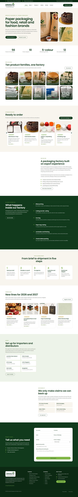</a> | <a href="https://greenleafpackbd.com/"></a> |

---

#### 13. DM Packaging Limited — Global Garment Packaging Manufacturer
| Property | Value |
| :--- | :--- |
| **Live URL** | [https://dmpackbd.com/ ↗](https://dmpackbd.com/) |
| **Domain** | Garment Export Packaging & Accessories |
| **Architecture** | International apparel catalog: glassine bags, paper hangers, RFID tracking tags, back boards, certified food-grade packaging. |

| Desktop (Complete Home Page Scroll) | Mobile Viewport |
| :---: | :---: |
| <a href="https://dmpackbd.com/"></a> | <a href="https://dmpackbd.com/"></a> |

---

#### 14. Green Cargo BD — Supply Chain Consulting & Logistics
| Property | Value |
| :--- | :--- |
| **Live URL** | [https://wahid.marketleadbd.com/ ↗](https://wahid.marketleadbd.com/) |
| **Domain** | Multimodal Cargo & Supply Chain Advisory |
| **Architecture** | Sea, air, and road cargo service catalog, consultation booking engine, enterprise inventory optimization frameworks. |

| Desktop (Complete Home Page Scroll) | Mobile Viewport |
| :---: | :---: |
| <a href="https://wahid.marketleadbd.com/"></a> | <a href="https://wahid.marketleadbd.com/"></a> |

---

### Category C: Enterprise, Real Estate & Educational Systems

---

#### 15. Imarah Holdings Ltd. — Real Estate & Property Development
| Property | Value |
| :--- | :--- |
| **Live URL** | [https://imarahholdings.com/ ↗](https://imarahholdings.com/) |
| **Domain** | Commercial & Residential Property Development |
| **Architecture** | Architectural project portfolio, luxury apartment specifications, construction progress milestones, installment schedule calculators. |

| Desktop (Complete Home Page Scroll) | Mobile Viewport |
| :---: | :---: |
| <a href="https://imarahholdings.com/"></a> | <a href="https://imarahholdings.com/">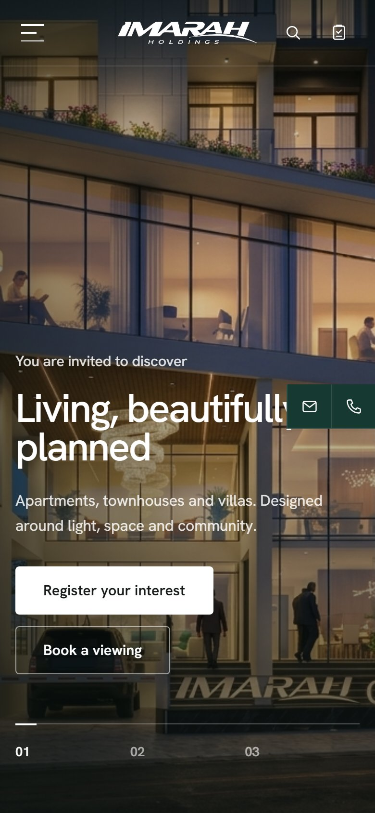</a> |

---

#### 16. Smart Vision Academy — Healthcare & Academic Coaching
| Property | Value |
| :--- | :--- |
| **Live URL** | [https://smartvisionacademybd.com/ ↗](https://smartvisionacademybd.com/) |
| **Domain** | EdTech & BNMC Nursing Licensure |
| **Architecture** | Nursing course enrollment portal, interactive online model exams, medical lecture series archives, publication order fulfillment. |

| Desktop (Complete Home Page Scroll) | Mobile Viewport |
| :---: | :---: |
| <a href="https://smartvisionacademybd.com/"></a> | <a href="https://smartvisionacademybd.com/"></a> |

---

#### 17. Apply Overseas BD — Global Education Advisory
| Property | Value |
| :--- | :--- |
| **Live URL** | [https://applyoverseasbd.com/ ↗](https://applyoverseasbd.com/) |
| **Domain** | Higher Education & Visa Advisory |
| **Architecture** | Global university program selector (Germany, Canada, UK, USA, Australia), student eligibility assessment, 1-on-1 advisor booking. |

| Desktop (Complete Home Page Scroll) | Mobile Viewport |
| :---: | :---: |
| <a href="https://applyoverseasbd.com/"></a> | <a href="https://applyoverseasbd.com/"></a> |

---

#### 18. Wahid Anwar — Executive Supply Chain Portfolio
| Property | Value |
| :--- | :--- |
| **Live URL** | [https://anowar.marketleadbd.com/ ↗](https://anowar.marketleadbd.com/) |
| **Domain** | Executive Portfolio & Supply Chain Faculty |
| **Architecture** | Thought leadership hub for GM Supply Chain at r-pac Bangladesh, 18+ years demand planning record, MBA curriculum, speaking archive. |

| Desktop (Complete Home Page Scroll) | Mobile Viewport |
| :---: | :---: |
| <a href="https://anowar.marketleadbd.com/"></a> | <a href="https://anowar.marketleadbd.com/">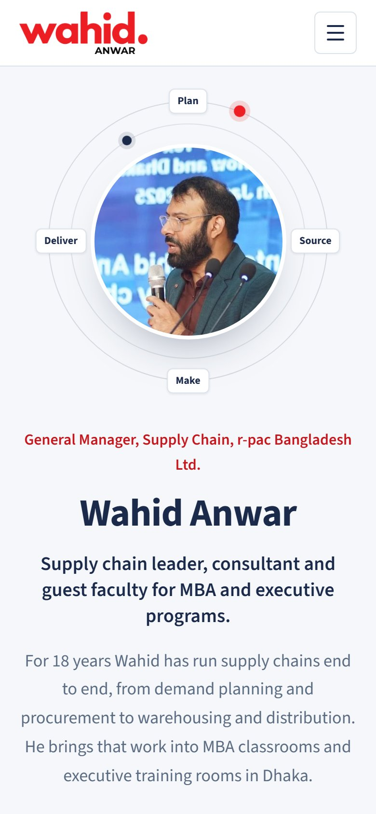</a> |

---

## 📈 Engineering Standards & Practices

- **Zero-Waste Laravel & Livewire:** Thin controllers delegating to domain actions, FormRequest boundary validation, eager loading (`with()`) eliminating N+1 queries by default, and index-optimized relational schemas.
- **Intelligent Autonomous Automation:** Building resilient scrapers and task agents using Puppeteer/Playwright and LLM function calling with zero manual intervention loops.
- **Zero-Trust Security:** Strict CSRF protection, secure `HttpOnly` sessions, parameterized database bindings, and bulletproof RBAC policies.

---

## 📬 Contact & Collaboration

Looking for an experienced engineer to architect your Laravel web application, scalable e-commerce infrastructure, or automated AI workflow?

- **Email:** [nurjamalbabu949@gmail.com](mailto:nurjamalbabu949@gmail.com)
- **GitHub:** [@nur949](https://github.com/nur949)
- **Location:** Dhaka, Bangladesh (Available for global remote contracts)

<div align="center">
  <sub>Engineered with precision by <a href="https://github.com/nur949">Nur</a>. Built for production scale.</sub>
</div>
